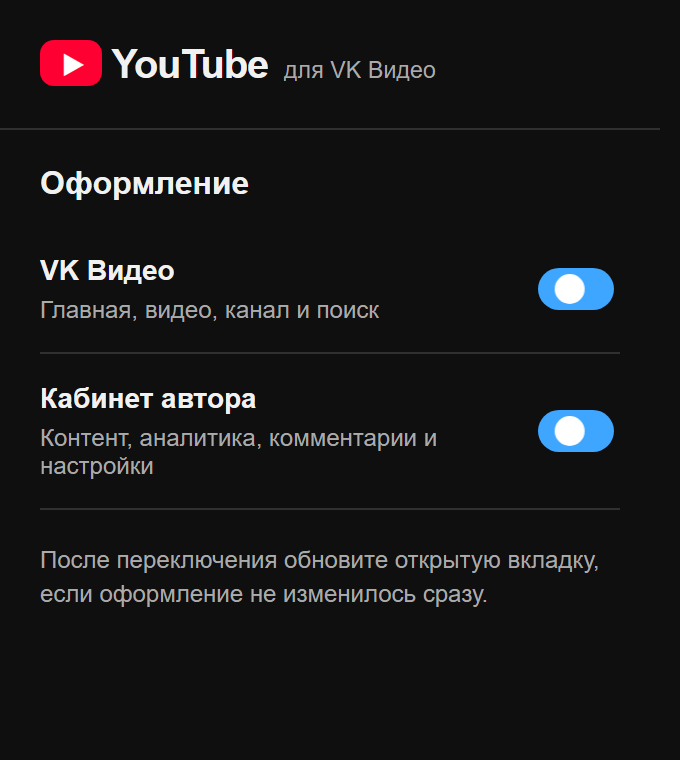
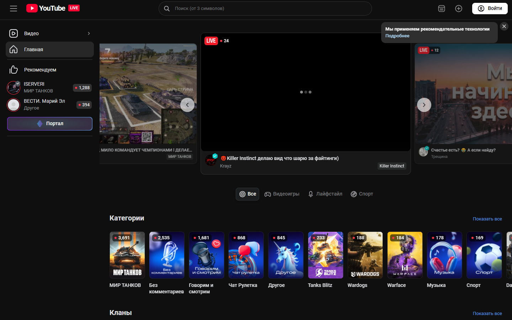
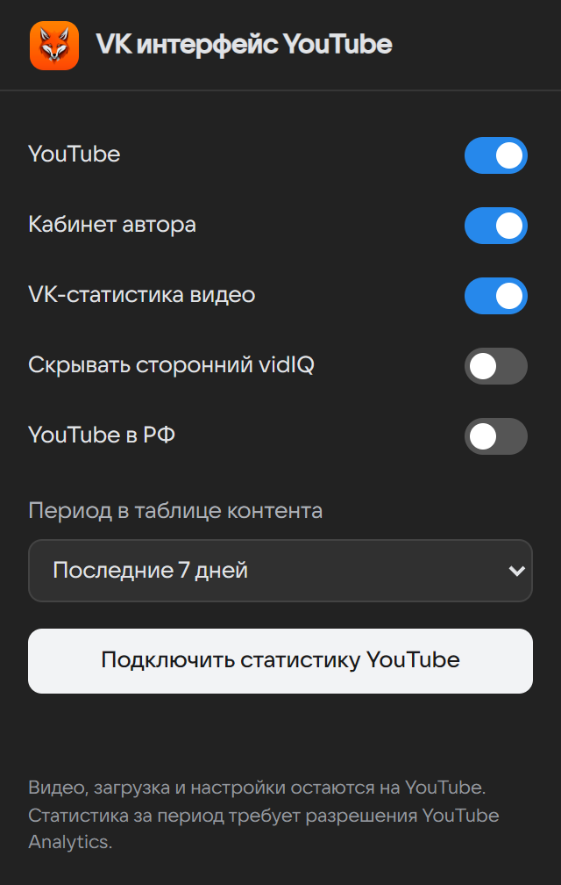
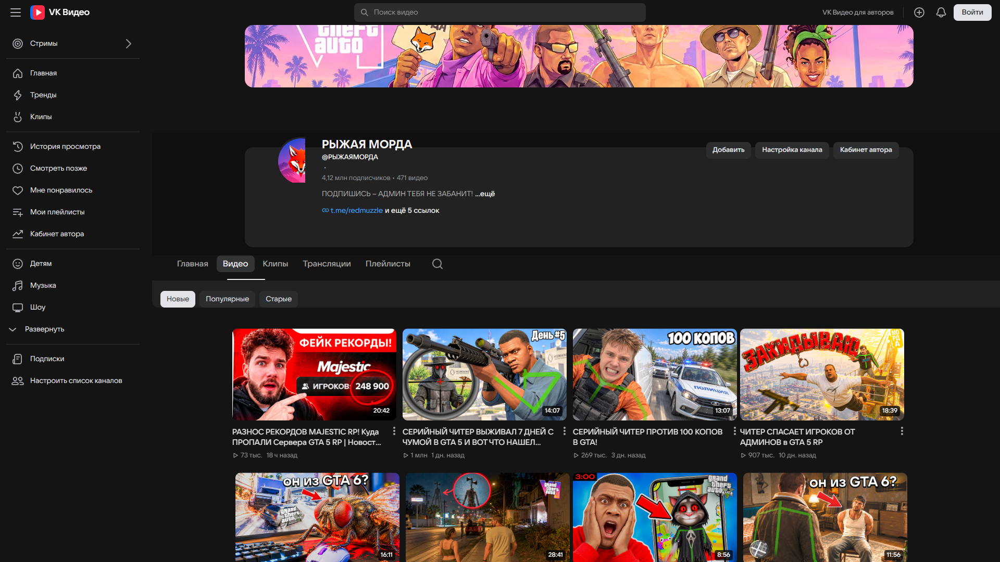
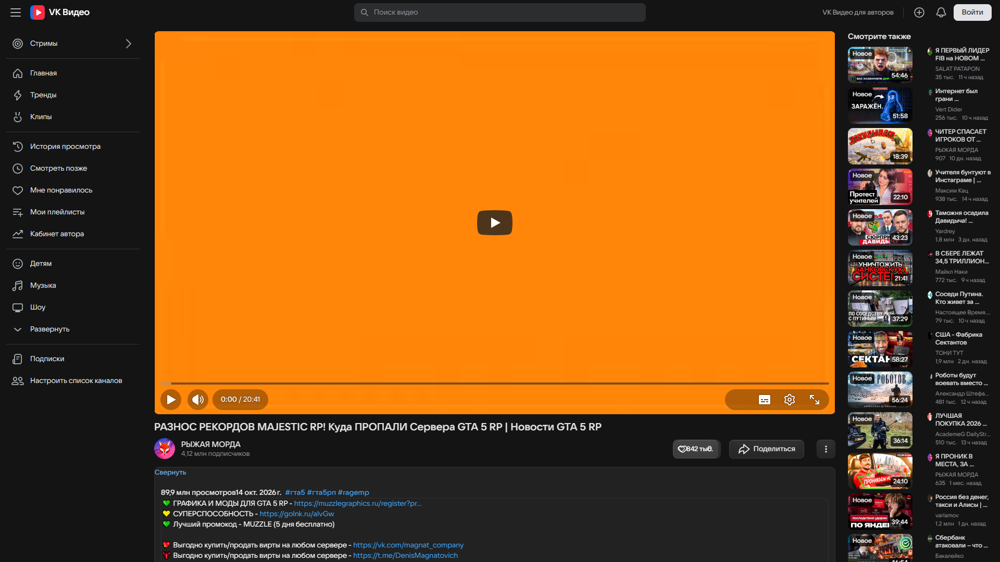

# YouTube в интерфейсе VK Видео

## Второе расширение: VK Видео в стиле YouTube

Теперь в репозитории есть отдельное расширение для обратного направления: оно оформляет **VK Видео и Кабинет автора** в стиле YouTube и YouTube Studio. Первое расширение для YouTube работает независимо.

- [Установщик для Windows](downloads/YouTube-for-VK-Setup-0.1.0.exe) и [его файл конфигурации](downloads/YouTube-for-VK-Setup-0.1.0.exe.config) — сохраните рядом и запустите установщик.
- [ZIP для Chrome и Edge](downloads/youtube-for-vk-0.1.0.zip) — распакуйте, откройте `chrome://extensions` или `edge://extensions`, включите режим разработчика и загрузите папку.
- [Исходники и подробная установка](reverse-extension/README.md).





---

Расширение для Chrome и Edge. Оно рисует YouTube и YouTube Studio так, как выглядит VK Видео, и не подменяет сами ролики.

## Для кого

Для зрителя, которому надоел обычный вид YouTube, и для автора канала, который смотрит свой кабинет. Подписки, рекомендации, загрузка, комментарии, плейлисты и аналитика остаются функциями YouTube. Меняется оболочка: шапка, меню, карточки, плеер и кабинет автора.

## Что остаётся YouTube

- Лента, поиск, история, клипы и рекомендации — настоящие, бесконечные.
- Плеер, качество, скорость, субтитры и звуковая дорожка — штатные.
- Кабинет автора работает с данными YouTube Studio.
- Переключатель «YouTube в РФ» по умолчанию выключен. Если его включить, главная показывает встроенную страницу [vkvideo.ru](https://vkvideo.ru/). Если кадр пустой, сайт VK не разрешил встраивание. Потоки VK расширение не скачивает.

## Что взято у VK Видео

Тёмная шапка и боковое меню, сетка из четырёх карточек, вкладки канала, описание со «Свернуть», колонка «Смотрите также», история сеткой по четыре и фильтры поиска в той же панели. Знак VK Видео в шапке сайта и знак VK в кабинете автора остаются знаками VK.

Лиса — только иконка самого расширения и картинка в окне настроек. Файл: `src/assets/fox-logo.jpg`.

## Как выглядит

### Окно расширения · 1.0.11



### Страницы YouTube





Это снимки более ранней сборки: они показывают оформление канала и страницы просмотра. В версии 1.0.11 исправлены расположение текста канала, строка просмотров, раскрытие описания и полноэкранный режим. Новые снимки этих страниц будут сделаны после проверки в подключённом YouTube.

Колонка «Смотрите также» и синяя галочка канала — с живых страниц VK Видео.

## Установка · 1.0.11

- [Скачать установщик для Windows](downloads/VK-YouTube-Setup-1.0.11.exe) — устанавливает расширение в Chrome или Edge. При скачивании сохраните рядом [файл конфигурации](downloads/VK-YouTube-Setup-1.0.11.exe.config).
- [Скачать ZIP расширения](downloads/vk-youtube-1.0.11.zip) — распакуйте архив, включите режим разработчика в `chrome://extensions` или `edge://extensions` и выберите «Загрузить распакованное расширение».

После обновления распакованного расширения нажмите ↻ на его карточке и обновите вкладки YouTube и YouTube Studio.

## Что можно поменять без логики

Цвета сайта: `--vk-bg`, `--vk-panel`, `--vk-text`, `--vk-accent` в `src/youtube-ui/site.css`.

Цвета кабинета: `--vkvk-bg`, `--vkvk-panel`, `--vkvk-accent` в `src/studio-ui/studio.css`.

Иконку расширения: заменить `src/assets/fox-logo.jpg` и пересобрать `icon16.png`, `icon32.png`, `icon48.png`, `icon128.png`.

## Сборка

```
npm install
npm test
npm run build
dotnet publish installer/VkYouTube.Setup.csproj -c Release
```

Готовая папка расширения — `dist`. Установщик кладёт её в Chrome или Edge.

## Ограничения версии 1.0.11

- Кабинет автора сверен по вёрстке без входа в чужой аккаунт. Если карточки всё ещё наезжают, это видно только в вошедшей студии.
- Короткое видео из другой страны может показать «Видео недоступно». Сама лента клипов при этом остаётся лентой YouTube, меняются только цвета и значки.
- Встроенный vkvideo.ru может быть пустым: это ограничение сайта VK, не подмена ленты YouTube.
