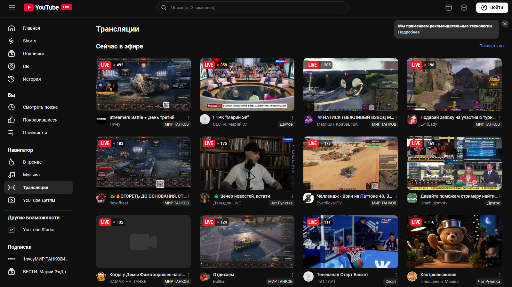
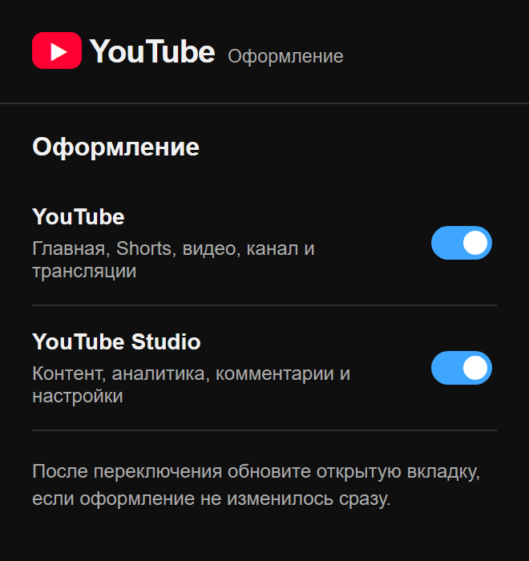

# YouTube: оформление VK Видео

Отдельное расширение для Chrome и Edge. Оформляет `vkvideo.ru`, `live.vkvideo.ru` и `cabinet.vkvideo.ru` в стиле YouTube и YouTube Studio. Открытые ролики, статистика, комментарии, публикация и настройки остаются штатными функциями VK Видео.

## Установка

Самый простой способ в Windows: скачайте [установщик 0.2.0](../downloads/YouTube-for-VK-Setup-0.2.0.exe) и [файл конфигурации](../downloads/YouTube-for-VK-Setup-0.2.0.exe.config) в одну папку, запустите установщик и выполните показанные шаги Chrome или Edge.

Вручную: распакуйте [ZIP 0.2.0](../downloads/youtube-for-vk-0.2.0.zip), откройте `chrome://extensions` или `edge://extensions`, включите «Режим разработчика», нажмите «Загрузить распакованное расширение» и выберите распакованную папку. После установки обновите вкладки VK Видео.

Для сборки из исходников в корне репозитория выполните `npm install`, `npm run build:reverse`, `npm run test:reverse`. Результат: `reverse-extension/dist`.

В окне расширения можно отдельно выключить оформление основного сайта и кабинета автора. Первое расширение «YouTube в интерфейсе VK Видео» продолжает работать независимо.

## Область оформления

- Главная: логотип YouTube, вкладка и иконка, поиск, меню в порядке YouTube, карточки видео и раздел Shorts.
- Просмотр: палец вверх на настоящей кнопке лайка VK и отдельный палец вниз. Отметка «Не нравится» хранится только в расширении: сайт VK не предоставляет действие дизлайка. Плеер и полноэкранный режим использует сам сайт.
- Трансляции: собственная страница с сеткой текущих эфиров вместо витрин и каруселей VK.
- YouTube Studio: логотип, названия и значки разделов, таблица контента, аналитика, комментарии, настройки и модальные формы.

Селекторы основаны на наблюдаемых `data-testid` VK. Если VK обновит разметку, часть оформления может потребовать обновления.
